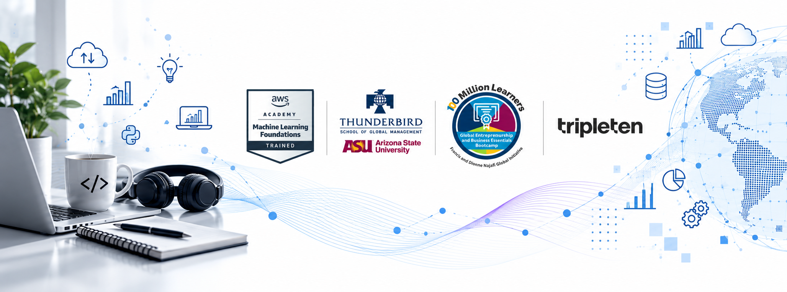

  

<h1 align="center">Hi, I'm Ana Paula Takezawa </h1>

<h3 align="center">Data Science | Machine Learning | Artificial Intelligence</h3>

---

### 👩‍💻 About Me

MBA graduate in Data Science and Artificial Intelligence, with a professional background in business development, financial analysis, risk management, and strategic decision-making.

I am passionate about transforming data into meaningful insights and developing data-driven solutions to real-world problems.

Currently focused on Data Science, Machine Learning, and Artificial Intelligence.

### 🛠️ Technical Skills

- **Programming:** Python, SQL
- **Data Analysis:** Pandas, NumPy, Matplotlib
- **Machine Learning:** Scikit-learn, XGBoost, LightGBM
- **Model Optimization:** Optuna, Feature Engineering, SHAP
- **Other Skills:** Exploratory Data Analysis (EDA), Statistics, Data Visualization

### 🎓 Education & Certifications

- **MBA in Data Science and Artificial Intelligence** — TripleTen Brasil
- **Machine Learning Foundations** — AWS Academy (20 hours)
- **Prompt Engineering for Software Engineers** — University of São Paulo (USP)
- **Introduction to Artificial Intelligence** — Ibmec
- **Global Entrepreneurship and Business Essentials Bootcamp** — Arizona State University / Thunderbird
- **Global Entrepreneurship and Innovation Foundations** — Arizona State University / Thunderbird

### 🚀 Featured Project

**Forest Fire Risk Prediction | Machine Learning**

Developed a predictive model using integrated environmental and meteorological datasets.

- Data processing and exploratory analysis
- Feature engineering and model optimization
- Machine Learning with XGBoost and LightGBM
- Model interpretability using SHAP
- **Final F1-Score: 81.16%**

🔗 [View Project on GitHub](https://github.com/anapaula-takezawa/projeto-final-mba-ciencia-dados-ia)

---

  <i>Turning data into insights and insights into solutions.</i>

